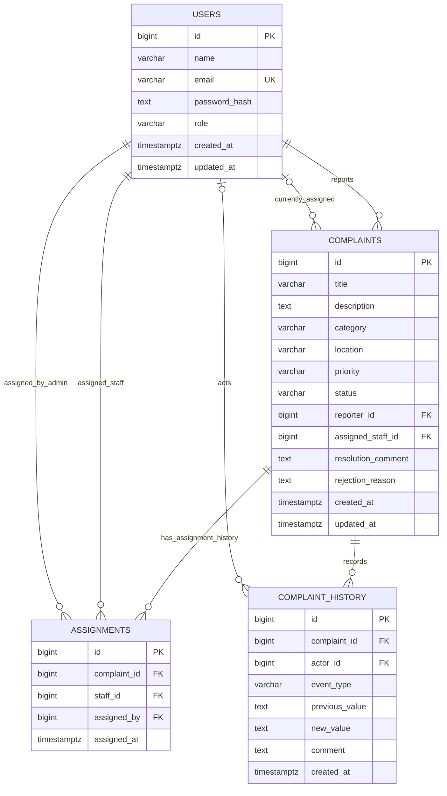

# CampusFix Review Guide

**Audience:** Member 1 — User Accounts and Complaint Submission  
**Module:** Authentication + Complaint Reporting  
**Stack:** PostgreSQL, Express, React, Node.js (PERN)

This guide follows the implementation in this repository. The review focus is the student path: register/sign in → receive a JWT → submit a complaint → save it with the student as reporter → read back only that student's complaints.

---

## 1. A short explanation to open your review

> CampusFix replaces informal campus maintenance reporting with a tracked workflow. My module owns the student entry point: student registration and login, password hashing, token-based authentication, complaint form validation, complaint creation, and reporter-level access control. A student report is saved in PostgreSQL with a foreign key to the student's user record. The API gets the reporter ID from the verified JWT, rather than trusting a reporter ID supplied by the browser.

The most important implementation path is:

```mermaid
sequenceDiagram
    actor Student
    participant UI as React (AuthPage / NewComplaint)
    participant API as Express routes + middleware
    participant Service as Service layer
    participant DB as PostgreSQL models

    Student->>UI: Register or sign in
    UI->>API: POST /api/auth/register or /login
    API->>Service: validate, hash/verify password
    Service->>DB: parameterized users query
    DB-->>Service: safe user fields
    Service-->>UI: user + signed JWT
    Student->>UI: Submit complaint form
    UI->>API: POST /api/complaints + Bearer JWT
    API->>API: verify JWT; require student role
    API->>Service: validate report; use req.user.id
    Service->>DB: transaction: complaint + initial history
    DB-->>UI: 201 Created + complaint
```

### Component / architecture diagram

This shows where the main pieces live and which direction requests/data flow. PostgreSQL is reached only through the backend model/data-access modules.

```mermaid
flowchart LR
    Browser[React browser UI<br/>AuthPage / NewComplaint] --> ClientAPI[client/src/api.js<br/>fetch wrapper + memory token]
    ClientAPI -->|HTTP + JSON + Bearer JWT| Express[server/src/app.js<br/>Express middleware]
    Express --> Routes[server/src/routes]
    Routes --> Auth[JWT auth + role middleware]
    Auth --> Controllers[server/src/controllers]
    Controllers --> Services[server/src/services<br/>rules + validation orchestration]
    Services --> Models[server/src/models<br/>parameterized SQL]
    Models --> Tx[server/src/config/db.js<br/>pg Pool + transactions]
    Tx --> PostgreSQL[(PostgreSQL<br/>users / complaints / history)]
    PostgreSQL --> Models
    Models --> Services --> Controllers --> Express --> ClientAPI --> Browser
```



---

## 2. Member 1 responsibilities and code map

| Responsibility | Implementation |
|---|---|
| Registration and login pages | `AuthPage` in `client/src/App.jsx`, routed at `/register` and `/login` |
| Keep API requests out of UI components | `client/src/api.js` |
| Keep the current login session | `AuthContext` in `client/src/App.jsx`; token held in module memory by `client/src/api.js` |
| Password rules and email normalization | `server/src/validators/auth.js` |
| Password hashing, comparison, token signing | `server/src/services/authService.js` |
| Auth HTTP endpoints | `server/src/routes/authRoutes.js`, `server/src/controllers/authController.js` |
| JWT verification and current-user claims | `server/src/middleware/auth.js`; `GET /api/auth/me` |
| Complaint form and success/error feedback | `NewComplaint` in `client/src/App.jsx` |
| Complaint request integration | `api.create` in `client/src/api.js` |
| Complaint validation and creation rules | `server/src/validators/complaints.js`, `server/src/services/complaintService.js` |
| Insert complaint and initial history event | `server/src/models/complaintModel.js` |
| Student ownership in list/detail reads | `server/src/models/complaintModel.js` and `server/src/services/complaintService.js` |
| Database relationship and constraints | `database/schema.sql` |

### Member 1: files to learn first for the review

If preparation time is limited, learn these files in this order. Be ready to trace one request across the layers instead of memorizing the whole repository.

| Priority | File | What to understand and be able to point out |
|---|---|---|
| 1 | `client/src/App.jsx` | Find `AuthPage` and explain how registration/login form submission, loading state, displayed errors, and successful navigation work. Find `NewComplaint` and explain the complaint fields, browser-side checks, submit action, success behavior, and what happens when the API returns an error. Also identify the auth/session context and protected routes. |
| 2 | `client/src/api.js` | Follow `api.register`, `api.login`, `api.me`, and `api.create` into the shared `request` function. Explain the API base URL, JSON request/response handling, Bearer token header, in-memory token, and how non-success/network responses reach the page. |
| 3 | `server/src/routes/authRoutes.js` and `server/src/controllers/authController.js` | Know the registration and login HTTP paths and rate limiting. The routes connect HTTP requests to controller functions; controllers pass the request data to the auth service and shape the JSON response. |
| 4 | `server/src/services/authService.js` | Be able to explain registration and login end to end: normalize email, hash a new password with bcrypt, compare the submitted password on login, return a generic invalid-credentials response, and sign the JWT. This is the main authentication business-logic file. |
| 5 | `server/src/middleware/auth.js` and `server/src/routes/complaintRoutes.js` | Explain how protected routes verify the JWT and how complaint creation requires the `student` role. Authentication establishes the request identity; role middleware limits the action. |
| 6 | `server/src/validators/auth.js` and `server/src/validators/complaints.js` | Know which fields are accepted and the key server-side validation rules. Explain that browser validation helps the user, while server validation is authoritative. The registration validator does not accept a role from the public form. |
| 7 | `server/src/services/complaintService.js` | Follow `create`: validate complaint details and use `req.user.id` (passed as `user.id`) as the reporter. Explain why the API must not trust a reporter ID sent by the browser. Also understand how student list/detail access is scoped. |
| 8 | `server/src/models/authModel.js` and `server/src/models/complaintModel.js` | Find the parameterized SQL. The auth model creates/looks up users without returning password hashes to normal responses. The complaint model inserts the complaint and initial history event in a transaction, filters student lists by reporter ID, and returns complaint detail/history. |
| 9 | `database/schema.sql` | Be able to describe the `users` and `complaints` columns and their relationship: `complaints.reporter_id` references `users.id`. Point out uniqueness/foreign-key/check constraints and explain how the relationship prevents a complaint from referring to a nonexistent reporter. |
| 10 | `server/src/middleware/errors.js` and `server/src/config/db.js` | Explain the shared safe error response path and how the database pool/transaction helper works. For complaint creation, a failure inserting either complaint or initial history should roll the transaction back. |

**Minimum request trace to rehearse:** `AuthPage` → `api.js` → auth route → auth controller → `authService` → auth model/PostgreSQL. Then for reporting: `NewComplaint` → `api.create` → complaint route + JWT/role middleware → complaint controller → `complaintService.create` → `complaintModel.createComplaint` → PostgreSQL transaction.

For the demonstration, make sure you can explain these three checks while submitting: the student is authenticated, the server takes reporter identity from the verified JWT, and the complaint plus its initial `Submitted` history event are committed together. Then show the complaint in the student’s list and use the SQL query later in this guide to prove it is persisted.

### What Member 1 owns in the database

- **`users`** stores identity, unique email, password hash, role, and timestamps.
- **`complaints`** stores the report. `reporter_id` is a required foreign key to `users.id`.
- On complaint creation, the server adds an initial **`complaint_history`** event in the same transaction. That gives the report an auditable `Submitted` entry from the moment it exists.
- `assignments` is used later by administration/staff workflow; Member 1 does not create assignment rows during student submission.

---

## 3. Folder and file structure

```text
CampusFix/
├── client/                       React single-page application
│   ├── .env.example              Optional frontend API URL
│   ├── index.html                 Vite HTML entry
│   ├── vite.config.js             Vite + React configuration
│   └── src/
│       ├── main.jsx               React bootstrap, BrowserRouter, global CSS
│       ├── App.jsx                Routes, auth context, screens, reusable UI
│       ├── api.js                  Central fetch/API service and in-memory token
│       └── styles.css              Responsive visual system and page styles
├── database/
│   ├── schema.sql                 Tables, constraints, indexes, relationships
│   └── seed.sql                   Explains why no default users/passwords are seeded
├── server/
│   ├── .env.example               Backend configuration template
│   ├── package.json               Backend scripts and runtime dependencies
│   ├── tests/
│   │   └── validators.test.js     Unit tests for registration/report validation
│   └── src/
│       ├── app.js                 Express middleware and route mounting
│       ├── server.js              Listen and graceful shutdown
│       ├── config/
│       │   ├── env.js             Validate/read environment configuration
│       │   └── db.js              PostgreSQL pool and transaction helper
│       ├── routes/                HTTP method/path → middleware/controller
│       ├── controllers/           HTTP request/response adapters
│       ├── services/              Business rules and workflow orchestration
│       ├── models/                 Parameterized PostgreSQL data access
│       ├── middleware/             Authentication, roles, errors
│       ├── validators/             Request input rules
│       └── scripts/                Schema initialization and trusted account setup
├── .gitignore                     Excludes node_modules, build output, and secrets
├── package.json                   Root workspace and combined commands
├── package-lock.json              Reproducible dependency versions
└── README.md                      Setup and operating instructions
```

### Backend separation of concerns

For a complaint submission, these layers have distinct jobs:

1. **Route** (`routes/complaintRoutes.js`) matches `POST /api/complaints`, authenticates, then requires the `student` role.
2. **Middleware** (`middleware/auth.js`) verifies the JWT and attaches its claims to `req.user`.
3. **Controller** (`controllers/complaintController.js`) passes the body and authenticated user to the service and returns HTTP `201`.
4. **Service** (`services/complaintService.js`) validates the report and supplies `user.id` as reporter ID.
5. **Model** (`models/complaintModel.js`) executes parameterized SQL and the transaction.
6. **Database** (`database/schema.sql`) enforces relational and value constraints even if another client bypasses the React form.

The controller intentionally does not contain SQL or the core ownership rule. The model does not make UI decisions or construct HTTP responses.

---

## 4. Authentication and complaint submission in depth

### Registration

1. React collects name, email, and password in `AuthPage`.
2. `api.register` sends JSON to `POST /api/auth/register`.
3. The route applies a rate limit (30 requests per 15 minutes) and calls the auth controller.
4. `validateRegistration` requires a 2–100 character name, a valid email format, and an 8–72 character password. The email is trimmed and lowercased.
5. `authService.register` hashes the password with `bcryptjs` at cost 12.
6. `authModel.createUser` inserts the user using `$1`, `$2`, `$3` SQL parameters. The SQL explicitly writes role `student`; any `role` sent by the browser is ignored.
7. The service signs a JWT and returns `{ user, token }`. The database never receives the plaintext password.

The initial administrator and maintenance staff are provisioned through trusted terminal commands (`npm run admin:create` and `npm run staff:create`), not public registration. Those commands also hash passwords before insertion.

### Login page use case: code locations and error handling

The page, network call, endpoint, and password check are in separate files. If the reviewer asks “where is login implemented?” follow this chain:

| Step | File and function | What it does |
|---|---|---|
| Screen and submit handler | `client/src/App.jsx` → `AuthPage` → inner `submit` | `/login` renders `AuthPage` with `register=false`; reads form fields, sets busy state, calls `api.login`, handles success/error |
| Shared API request | `client/src/api.js` → `api.login` → `request` | POSTs JSON to `/auth/login`; parses response, throws API error text for non-2xx responses |
| Route | `server/src/routes/authRoutes.js` | Maps `POST /api/auth/login` to the controller and applies the auth rate limit |
| HTTP adapter | `server/src/controllers/authController.js` → `login` | Passes the request body to auth service and serializes its result |
| Login business logic | `server/src/services/authService.js` → `login` | Normalizes email, loads user, uses `bcrypt.compare`, rejects invalid credentials, signs JWT |
| User lookup | `server/src/models/authModel.js` → `findUserByEmail` | Parameterized query by unique email |
| Shared failures | `server/src/middleware/errors.js` → `errorHandler` | Turns validation/database/unexpected failures into safe HTTP JSON errors |

**Login exception/error path:**

1. The browser's `required` and `type="email"` checks prevent a normal form submit when fields are empty or email syntax is obviously wrong. This is client-side convenience only.
2. Wrong email/password: `authService.login` throws `AppError(401, ...)` with the same message for either case. The controller promise rejection reaches Express error middleware; the client displays the returned message under the form.
   Express 5 forwards rejected promises from async route/controller functions to the error middleware automatically.
3. Expired/missing JWT on a protected request: `authenticate` in `server/src/middleware/auth.js` returns `401`. The API client dispatches `campusfix:unauthorized`, and `App` clears the in-memory session. A 401 during login still leaves the user on the login page, where `AuthPage` displays the login error.
4. Duplicate email on registration: PostgreSQL unique violation code `23505` is translated to `409` with a duplicate-account message by `errorHandler`.
5. Invalid registration/report fields: the validator throws a `400 AppError`; no SQL insert follows.
6. Rate limit: after 30 registration/login attempts in 15 minutes, the limiter returns JSON with status `429`; the form shows its message like other API errors.
7. Unexpected server/database failure: `errorHandler` logs details on the server, but returns a generic `500` message so SQL details/stack traces are not sent to the browser. `request` also falls back to a generic message if a server response is not JSON.
8. Fetch/network failure (server unavailable, connection dropped): `fetch` rejects; the page's `catch` displays the caught message and its `finally` block clears the busy indicator.

Registration shares the `AuthPage` component with `register=true`; the route is `/register`, and its submit path calls `api.register` → `/api/auth/register` → `authService.register`. The form has no role picker. The validator returns only `name`, `email`, and `password`, then the SQL model hardcodes the `student` role.

### Complaint form use case: code locations and error handling

| Step | File and function | What it does |
|---|---|---|
| Form screen and submit | `client/src/App.jsx` → `NewComplaint` → inner `submit` | Reads `FormData`, shows busy/error state, calls `api.create`, navigates to detail after `201` |
| Shared API request | `client/src/api.js` → `api.create` → `request` | Adds the in-memory Bearer token and sends JSON to `/api/complaints` |
| Route + permission | `server/src/routes/complaintRoutes.js` | `router.use(authenticate)` then `allowRoles('student')` on complaint creation |
| HTTP adapter | `server/src/controllers/complaintController.js` → `create` | Passes `req.body` and verified `req.user` to service; returns `201` |
| Validation/identity | `server/src/services/complaintService.js` → `create` | Calls `validateComplaint`; passes `user.id` as reporter rather than trusting the body |
| Database transaction | `server/src/models/complaintModel.js` → `createComplaint` | Inserts complaint and initial Submitted history event together |
| Error response | `server/src/middleware/errors.js` | Converts expected validation/constraint errors; hides unexpected internals |

Browser `required`, `minLength`, and `maxLength` rules give immediate form feedback. Server validation remains authoritative. The form catches a rejected API call and displays it while preserving typed fields; on success it navigates to the complaint detail and shows confirmation. The transaction is the database exception boundary: if either insert fails, it rolls back both.

### Login and authenticated requests

- `POST /api/auth/login` finds the normalized email and checks the submitted password with `bcrypt.compare`.
- The response has a generic “Email or password is incorrect” error for unknown email and wrong password, avoiding an account-enumeration hint.
- A signed JWT contains the user's ID, role, and name, expires according to `JWT_EXPIRES_IN` (default: two hours), and is signed using `JWT_SECRET`.
- Protected requests send `Authorization: Bearer <token>`. `authenticate` verifies signature/expiry and puts claims in `req.user`.
- `GET /api/auth/me` returns the ID, role, and name from those **verified token claims**. It does not reload the user row from PostgreSQL on each request.
- The frontend keeps the token in JavaScript memory, not `localStorage` or `sessionStorage`. A page reload clears the token and the student must sign in again. This reduces persistence of a stolen bearer token, with the usability tradeoff of no persistent login.

### Complaint form and API creation

`NewComplaint` sends `title`, `description`, `category`, and `location`. The backend validates again; browser validation is for usability, not authorization or trust.

Current server rules:

| Field | Rule |
|---|---|
| Title | 5–140 trimmed characters |
| Description | 15–5,000 trimmed characters |
| Category | One of Electrical, Plumbing, Furniture, IT & Wi-Fi, Classroom Equipment, Cleanliness, Safety, Other |
| Location | 2–140 trimmed characters |
| Priority | Chosen by server default `Medium`; student does not set priority at submission |
| Initial status | Server/database default `Submitted` |
| Reporter | `req.user.id` from JWT; never accepted from request body |

`createComplaint` wraps two writes in `inTransaction`: insert the complaint, then insert its initial status-history row. If either insert fails, both are rolled back. PostgreSQL constraints provide a second line of validation.

After success, the API responds with status `201`. React navigates to the new detail page and displays the “Your request is in” confirmation. On failure, the API returns a safe `{ "error": "..." }` response and the form displays it without losing the typed values.

### How student ownership is enforced

This is backend enforcement, not just a hidden UI button:

- The student role is required for complaint creation.
- `listComplaints` adds `c.reporter_id = $n` for students, using the authenticated ID.
- `detail` compares the stored complaint reporter ID with the JWT user ID and returns `403` if they do not match.
- A student cannot call admin assignment/priority/rejection routes or staff status-update routes because those routes have role middleware.
- Queries use parameters for all values. The few dynamically assembled SQL fragments are fixed clauses; supplied values go in the parameter array.

---

## 5. Database design and relationships



### Key relational decisions

- A single user can report many complaints; every complaint has exactly one reporter (`reporter_id NOT NULL`). The FK uses `ON DELETE RESTRICT`, so a reporter cannot be deleted while their complaints exist.
- `assigned_staff_id` is the complaint's **current** assignee for fast reads. `assignments` retains each assignment/reassignment with staff, assigning admin, and timestamp.
- `complaint_history` is an append-style event log for initial submission, status transitions, assignments, priority changes, and rejection reasons. It records actor, values/comment, and database time.
- `password_hash` is never returned by normal account creation/login queries.
- Role, status, priority, and category are constrained by `CHECK` constraints. Email is `UNIQUE`; foreign keys prevent orphaned complaint records.
- Indexes support reporter lists, staff queues, status/category/priority filters, and complaint history/assignment lookups. Free-text search and location matching currently do not have dedicated indexes.
- `BIGSERIAL` IDs provide generated numeric keys; application responses may represent PostgreSQL `bigint` values as strings, which is normal for the `pg` driver.

### Table-by-table review prompts

**`users`**: “Why hash passwords?” A database leak should not immediately reveal users' passwords. bcrypt is intentionally slow and salted; the stored hash is what `bcrypt.compare` checks. Email uniqueness prevents duplicate accounts. Public registration always assigns `student`.

**`complaints`**: “How do you know who filed it?” `reporter_id` is a foreign key set from verified server-side JWT claims. The row keeps current status and assignee, along with details needed to list/filter it without replaying history.

**`assignments`**: “Why is assignee stored twice?” `complaints.assigned_staff_id` is a current-state shortcut; `assignments` is history, so reassignment does not erase the earlier assignment.

**`complaint_history`**: “How do you show progress?” Read events ordered by `created_at, id`. `previous_value`/`new_value` describe changes and `comment` stores progress, resolution, or rejection text.

---

## 6. API endpoint reference

All paths below are prefixed with `http://localhost:4000`. Except registration, login, and health, the API expects a valid `Authorization: Bearer <JWT>` header. Request bodies are JSON objects. Errors use a consistent `{ "error": "message" }` shape.

### Member 1 endpoints

| Method + path | Access | Request | Success |
|---|---|---|---|
| `POST /api/auth/register` | Public, rate-limited | `{ "name", "email", "password" }` | `201 { "user": {id,name,email,role}, "token" }`; role is always `student` |
| `POST /api/auth/login` | Public, rate-limited | `{ "email", "password" }` | `200 { "user": {id,name,email,role}, "token" }` |
| `GET /api/auth/me` | Any valid JWT | No body | `200 { "user": {id,role,name} }` |
| `POST /api/complaints` | Student JWT | `{ "title", "description", "category", "location" }` | `201 { "complaint": ... }`; reporter from token, priority Medium, status Submitted |
| `GET /api/complaints` | Any valid JWT | Optional query filters | `{ "complaints": [...] }`; students see own, staff assigned, admin all |
| `GET /api/complaints/:id` | Any valid JWT, ownership/assignment checked | No body | `{ "complaint": { ..., "history": [...], "assignments": [...] } }` |

Complaint list query filters supported by the API: `search`, `status`, `category`, `priority`, and `location`. Results are ordered by most recently updated and limited to 200 rows.

### Other workflow endpoints (useful context for Member 1)

| Method + path | Access | Purpose |
|---|---|---|
| `GET /api/complaints/dashboard` | Admin | Database-backed total/status/category counts |
| `GET /api/complaints/staff` | Admin | List staff available for assignment |
| `POST /api/complaints/:id/assign` | Admin | Body `{ "staffId": 12 }`; assign or reassign a staff member |
| `POST /api/complaints/:id/reject` | Admin | Body `{ "reason": "..." }`; reason required and recorded |
| `PATCH /api/complaints/:id/priority` | Admin | Body `{ "priority": "High" }` |
| `PATCH /api/complaints/:id/status` | Staff | Body `{ "status": "In Progress", "comment": "..." }` or `Resolved`; only assigned staff and valid next status allowed |
| `GET /api/health` | Public | API process health check; returns `{ "status": "ok" }` |

### Useful HTTP codes

- `200`: successful read/update/login.
- `201`: account or complaint created.
- `400`: malformed/invalid input or database constraint validation.
- `401`: missing, invalid, or expired JWT; or invalid login.
- `403`: valid identity but wrong role/ownership/assignment.
- `404`: unknown endpoint/complaint.
- `409`: duplicate email or invalid workflow transition.
- `429`: authentication rate limit reached (JSON error body).
- `500`: unexpected server error; response does not expose stack traces or SQL details.

---

## 7. Design patterns and engineering practices used

These are architectural patterns in the code, not claims that a specific Gang of Four class hierarchy was added.

1. **Layered architecture / MVC-style separation:** routes, controllers, services, models, validators, and middleware divide responsibilities. The controller is the HTTP adapter; the service owns business rules; models own SQL.
2. **Service layer:** `authService` orchestrates validation, hashing, persistence, and token issuance. `complaintService` orchestrates validation, actor identity, ownership, and workflow outcomes.
3. **Data Access Object (DAO)-style modules:** `authModel` and `complaintModel` centralize database reads/writes and hide SQL from UI/controllers. They are simple modules rather than a generic ORM/repository framework.
4. **Middleware pipeline / chain of responsibility:** Express applies security headers, CORS, JSON parsing, auth, role authorization, routes, 404 handling, and centralized errors in sequence.
5. **Dependency boundary:** React components call `client/src/api.js`; controllers call service modules; services call model modules. This keeps network/SQL details from spreading through components.
6. **Unit of Work / transaction boundary:** `inTransaction` groups complaint creation + initial history and other related updates so partial writes roll back.
7. **Validation at multiple boundaries:** browser form constraints improve usability; server validators are authoritative; database checks and foreign keys protect stored data.

No classic Singleton/Factory/Observer framework has been added, and none is needed for this app's scope. The React auth context is a shared state provider, not a persisted server session. If asked “what pattern did you use?”, lead with layered architecture, service layer, DAO-style data access, and transaction boundary.

---

## 8. Security points to be ready to explain

- **Never trust client-supplied identity:** complaint body has no reporter field. `req.user.id` is derived from the signed JWT.
- **No public administrator creation:** registration model hardcodes the student role. Privileged accounts require trusted terminal access.
- **Hash, do not encrypt, passwords:** passwords are one-way bcrypt hashes, cost 12. Login compares the submitted password against the hash.
- **Parameterized SQL:** request values are sent as query parameters (`$1`, `$2`), helping prevent SQL injection.
- **Role checks and record checks are separate:** role middleware says what class of action a role can take; service/model checks which specific complaint the user owns or is assigned.
- **Safe API errors:** expected validation/authorization errors are readable; unexpected errors are logged server-side and returned generically.
- **Token-storage tradeoff:** memory-only JWT avoids long-lived browser storage, but reload requires sign-in. Production still needs HTTPS, a strong private JWT secret, secret rotation practices, and careful XSS prevention.
- **CORS is not authorization:** it restricts browser origins; backend JWT and role/ownership checks are what protect data.
- **Request body size is capped at 32 KB;** Helmet supplies standard security headers, and login/register are rate-limited.

---

## 9. SDLC: how to explain the project lifecycle

Present this as the **iterative/incremental process appropriate to this implementation**; do not claim a formal methodology or ceremonies that your team did not actually use.

1. **Requirements:** identify the informal-reporting problem; define roles, complaint fields, statuses, permissions, and the end-to-end outcome.
2. **Analysis:** map student, admin, and staff use cases; define acceptance criteria such as “student submits a report and can see it afterward” and “student cannot read another student's report.”
3. **Design:** choose PERN; define normalized tables, API contracts, workflow transitions, role checks, UI navigation, and service/model boundaries.
4. **Implementation in increments:** build environment/database setup; authentication; student submission/list/detail; then assignment, staff progress, history, dashboards. Keep each feature end-to-end across UI, API, and database.
5. **Verification:** run validator unit tests, production client build, API smoke tests with role-specific accounts, SQL checks, negative permission/transition tests, and a restart test for persistence.
6. **Release/setup:** initialize PostgreSQL, set secrets/origins, provision admin/staff, start API + Vite; for deployment build the client and serve it with the API behind HTTPS/reverse proxy.
7. **Maintenance:** collect review feedback, prioritize defects, add DB migrations as schema evolves, review access/security, and rerun regression checks after changes.

### Member 1 acceptance criteria

- A valid student can register and log in.
- A password is stored as a bcrypt hash, never plaintext.
- Public registration cannot create admin/staff accounts, even if it submits a `role` field.
- A valid JWT is required to create a complaint.
- A student complaint is stored with correct title/description/category/location, status `Submitted`, priority `Medium`, and the authenticated reporter ID.
- Invalid fields produce a useful error and do not create a partial complaint.
- The complaint insert and initial history insert either both commit or both roll back.
- A student list/detail request is scoped to their own records; changing the URL ID does not grant access.
- A successful submit gives clear feedback and the new complaint appears in the student's list/detail after navigation or server restart.

---

## 10. Review demonstration: student report saved in PostgreSQL

### Prepare the local environment

From the repository root:

1. Ensure PostgreSQL is running and create a UTF-8 database:

   ```sql
   CREATE DATABASE campusfix WITH ENCODING 'UTF8' TEMPLATE template0;
   ```

2. Copy `server/.env.example` to `server/.env`. Set `DATABASE_URL` for that database and a random `JWT_SECRET` with at least 32 characters. Do not commit `.env`.
3. Initialize the schema and start the app:

   ```powershell
   npm install
   npm run db:init
   npm run dev
   ```

4. Open `http://localhost:5173/register`. Student registration is public; no seeded credentials are required. If you need an admin/staff login for the larger workflow, create one from a trusted terminal with `npm run admin:create` / `npm run staff:create`.

### Submit the report

Register a student, then submit a concrete report such as:

- **Title:** Projector lamp not working
- **Description:** The projector lamp does not turn on in the morning lecture, and the room is too dark to see the board.
- **Category:** Classroom Equipment
- **Location:** Main Block, Room 204

Show the success message, generated request number, `Submitted` status, and the first history event. Navigate to **My complaints** and show the same request there.

### Prove it is stored in PostgreSQL

Connect with `psql` using the same database configured by `DATABASE_URL`, then run:

```sql
SELECT
  c.id,
  c.title,
  c.category,
  c.location,
  c.priority,
  c.status,
  c.reporter_id,
  u.name AS reporter_name,
  u.email AS reporter_email,
  c.created_at
FROM complaints AS c
JOIN users AS u ON u.id = c.reporter_id
ORDER BY c.created_at DESC
LIMIT 10;
```

Then show the creation event:

```sql
SELECT h.event_type, h.new_value, h.created_at, u.name AS actor
FROM complaint_history AS h
LEFT JOIN users AS u ON u.id = h.actor_id
WHERE h.complaint_id = 17
ORDER BY h.created_at, h.id;
```

Replace `17` in that example with the complaint ID you are demonstrating.

Explain that the joins prove `complaints.reporter_id` points to a real `users.id`, and that initial status history was written in the same transaction. For a quick API-only check, sign in via UI, inspect the browser Network panel for `POST /api/complaints` → `201`, then inspect `GET /api/complaints` and note it only returns the signed-in student's reports.

### Negative checks if the reviewer asks

- Try an invalid title or a description under 15 characters: validation error, no row inserted.
- Register with an extra `"role":"admin"` property: returned role is still `student`.
- Sign in as a second student and try the first student's complaint URL: expected `403`.
- Submit without a token: expected `401`.

---

## 11. PostgreSQL commands to keep ready

### Connect from Windows PowerShell

Use the hostname, port, database, and database username from `server/.env`'s `DATABASE_URL` (do not paste that URL into screenshots if it contains a password). With PostgreSQL's usual local defaults:

```powershell
psql -h localhost -p 5432 -U postgres -d campusfix
```

If `psql` is not on `PATH`, use the installed client executable (adjust PostgreSQL version if needed):

```powershell
& 'C:\Program Files\PostgreSQL\16\bin\psql.exe' -h localhost -p 5432 -U postgres -d campusfix
```

It will prompt for the database password. Once at the `campusfix=#` prompt, these are **psql meta-commands** (they begin with `\`; they are not SQL and need no semicolon):

```text
\conninfo
\l
\c campusfix
\dt
\d+ users
\d+ complaints
\d+ assignments
\d+ complaint_history
\x on
\q
```

Use SQL (with a trailing semicolon) in psql or pgAdmin Query Tool:

```sql
-- List public tables (portable SQL alternative to psql's \dt)
SELECT table_name
FROM information_schema.tables
WHERE table_schema = 'public' AND table_type = 'BASE TABLE'
ORDER BY table_name;

-- Inspect columns and nullability for a table
SELECT column_name, data_type, is_nullable, column_default
FROM information_schema.columns
WHERE table_schema = 'public' AND table_name = 'complaints'
ORDER BY ordinal_position;

-- Show users safely: do not select password_hash for a live review/demo
SELECT id, name, email, role, created_at
FROM users
ORDER BY id DESC
LIMIT 10;

-- Prove passwords are hashes without printing the hash itself
SELECT email, role, password_hash LIKE '$2%' AS bcrypt_hash_present
FROM users
ORDER BY id DESC
LIMIT 10;

-- Show the last 10 complaints joined to the reporter
SELECT c.id, c.title, c.category, c.location, c.priority, c.status,
       c.reporter_id, u.name AS reporter_name, u.email AS reporter_email,
       c.created_at, c.updated_at
FROM complaints AS c
JOIN users AS u ON u.id = c.reporter_id
ORDER BY c.created_at DESC
LIMIT 10;

-- Show one complaint's history: replace 17 with an ID from the query above
SELECT event_type, previous_value, new_value, comment, created_at
FROM complaint_history
WHERE complaint_id = 17
ORDER BY created_at, id;

-- Count complaints by current status
SELECT status, COUNT(*) AS total
FROM complaints
GROUP BY status
ORDER BY status;
```

For pgAdmin, select the `campusfix` database, open **Query Tool**, paste only a SQL statement (not `\d`/`\dt`), and press Execute. The `information_schema` and `SELECT` queries work in both psql and pgAdmin.

---

## 12. Commands and testing

```sh
npm install
npm run db:init
npm run admin:create       # interactive; private password prompt
npm run staff:create       # interactive; private password prompt
npm run dev                # API :4000 + Vite :5173
npm run build              # production client build
npm test --workspace server
```

The committed automated tests focus on validators (`server/tests/validators.test.js`). The end-to-end review demonstration above verifies actual DB persistence. `database/schema.sql` is idempotent for initial setup/re-running, but it is not a versioned migration system: for future schema changes, add ordered migrations and test upgrades on a copy of data.

---

## 13. Likely viva questions and concise answers

**Why PERN?** PostgreSQL gives relationships, constraints, transactions, and reliable queries; Express/Node provides a JavaScript REST API; React provides a responsive role-aware client. One language across client/server reduces context switching.

**Why keep business rules out of routes/controllers?** So HTTP handling stays thin, rules are reusable/testable, and database code is isolated from transport/UI details.

**How is SQL injection prevented?** User values are passed separately as `pg` query parameters. We never concatenate user strings into SQL values.

**How do you know the complaint reporter?** From the authenticated JWT claims, not the request JSON. Database foreign keys validate that user exists.

**What happens if complaint insertion succeeds but history insertion fails?** The transaction rolls back both writes, so the database does not keep an incomplete report.

**Can the student select Critical priority?** No. Student creation leaves the DB/server default `Medium`; admin changes priority through a separate role-protected endpoint and it is audited.

**Can a user change their role in registration?** No. The validator only returns name/email/password and the model inserts role as the literal `'student'`.

**How do you prevent one student from opening another student's complaint?** List queries include the reporter ID filter; detail service checks the complaint reporter against verified JWT ID and returns 403 on mismatch.

**Does `GET /api/auth/me` query PostgreSQL?** No. It verifies the JWT first, then returns its ID/role/name claims. A valid token proves it was signed by the server and has not expired.

**Why is the token lost after refresh?** The current app intentionally keeps the JWT in memory instead of persistent browser storage. The user signs in again after reload.

**What does the initial history event provide?** An audit entry for `Submitted`, tied to actor and timestamp, so the complaint history begins at creation.

**What would you improve next?** Versioned migrations, integration tests in CI against disposable PostgreSQL, pagination instead of a 200-row cap, refresh/session strategy if persistent login is required, email notifications, and production HTTPS/observability.
