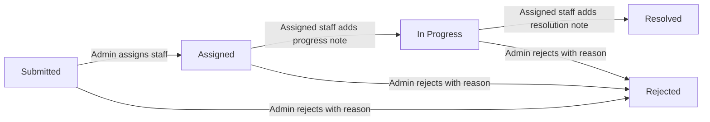
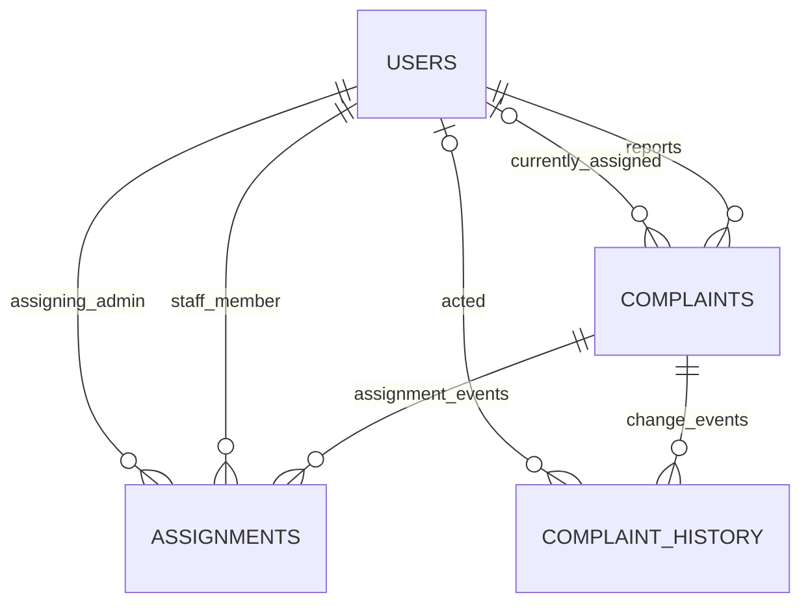

# CampusFix Review Guide — Member 2

**Module:** Admin Management + Staff Resolution  
**Ownership:** The complaint lifecycle after a student submits a request: administrators review, filter, assign and prioritize; assigned staff record progress and resolution; changes are retained in the complaint history.

## How to explain the module

“Member 2 owns the operational workflow. The administrator dashboard reads live complaint counts from PostgreSQL. An administrator can inspect complaints, assign or reassign a maintenance staff member, change priority, or reject an invalid report with a reason. Assigned staff can move a complaint through the permitted steps and must add a progress or resolution note. The API checks the role and complaint assignment, and the database transaction records the change and its history together.”

## Important files and what they do

Paths below are relative to the project root.

| File | Responsibility and important functionality |
|---|---|
| `client/src/App.jsx` | Implements the role-aware screens. `Dashboard` fetches actual admin dashboard counts and complaint data, or the signed-in staff member’s assigned queue. `ComplaintList` displays complaints and filters. `ComplaintDetail` displays complaint information, assignment history, and the event timeline. Its admin controls call assignment, priority, and rejection actions; its staff controls collect a progress/resolution comment and offer the next valid status action. Loading, error, and action feedback are handled here. |
| `client/src/api.js` | Central HTTP client. Adds the in-memory Bearer token, serializes JSON, parses API responses, and raises readable errors. Module 2 calls include `api.complaints`, `api.complaint`, `api.dashboard`, `api.staff`, `api.assign`, `api.priority`, `api.reject`, and `api.status`. |
| `server/src/routes/complaintRoutes.js` | Defines complaint URLs and applies authentication to the complaint router. Dashboard, staff list, assign, reject, and priority routes require `admin`; status updates require `staff`. Complaint listing/detail are authenticated and their record-level access is checked in the service/model path. This is the backend permission boundary; frontend visibility alone is not security. |
| `server/src/controllers/complaintController.js` | Thin HTTP adapters. Reads route parameters, query strings, request bodies, and authenticated `req.user`; invokes the service; returns JSON. It contains no SQL or workflow implementation. |
| `server/src/services/complaintService.js` | Workflow/business rules. Validates IDs and user input, requires comments for progress, resolution, and rejection, delegates work to the model, and translates missing records, wrong assignment, and invalid transitions into appropriate HTTP errors. |
| `server/src/models/complaintModel.js` | PostgreSQL data-access layer. Builds filtered complaint lists; scopes student results to reporter and staff results to assignee; loads detail plus history and assignment records; lists staff; calculates dashboard counts; and performs assignment, priority, rejection, and status writes using parameterized SQL. Related writes use transactions and row locks. |
| `server/src/validators/complaints.js` | Shared input rules for complaint fields, allowed priorities, and required comments. Priority values are Low, Medium, High, or Critical. Comments are trimmed and bounded in length. |
| `server/src/middleware/auth.js` | Verifies JWTs and provides `allowRoles(...)` middleware. A valid login establishes identity; role middleware limits which class of user may call each administrative/staff endpoint. |
| `server/src/middleware/errors.js` | Central error handling. Converts expected application/database errors to safe JSON responses and prevents internal stack/SQL details from being sent to the client. |
| `server/src/config/db.js` | Creates the PostgreSQL pool and provides `inTransaction`, used to commit a complete lifecycle change or roll it back on failure. |
| `server/src/app.js` | Configures Express middleware, mounts API routes, and installs not-found and centralized error handling. Useful when explaining how a request reaches the complaint router. |
| `database/schema.sql` | Defines the relational tables, foreign keys, checks, and indexes. The key Module 2 tables are `complaints`, `assignments`, and `complaint_history`; `users` identifies the reporter, staff member, assigning admin, and event actor. |

## Lifecycle and rules implemented



- An admin can assign or reassign a complaint only to a user whose role is `staff`. A first assignment changes `Submitted` to `Assigned`; reassignment retains the current workflow status. Resolved and Rejected complaints cannot be assigned.
- Staff can update only a complaint assigned to their own user ID. The implemented transitions are `Assigned → In Progress` and `In Progress → Resolved`; each requires a comment. The resolution comment is also stored on the complaint for convenient display.
- Admin priority changes are checked against the allowed values. A history row is added when the priority actually changes.
- Admin rejection requires a reason. It sets status to `Rejected` and records the reason. Resolved and already Rejected complaints cannot be rejected again.
- Role checks protect endpoint classes; service/model checks protect the specific complaint and transition. The database constraints and foreign keys provide additional integrity protection.

## API endpoints handled by this module

All endpoints use the API base `/api`. Except health, these complaint endpoints require a valid JWT.

| Method and path | Permission | What it does |
|---|---|---|
| `GET /complaints/dashboard` | Admin | Returns database-derived total, per-status, and per-category counts. |
| `GET /complaints/staff` | Admin | Returns staff accounts for the assignment selector. |
| `GET /complaints` | Authenticated | Lists complaints; administrators see all, staff see assigned complaints, and students see their own. Supports `search`, `status`, `category`, `priority`, and `location` filters; results are capped at 200. |
| `GET /complaints/:id` | Authenticated with record access check | Returns complaint details, history, and assignment history. |
| `POST /complaints/:id/assign` | Admin | JSON body `{ "staffId": 12 }`; assigns/reassigns and logs the change. |
| `PATCH /complaints/:id/priority` | Admin | JSON body `{ "priority": "High" }`; updates priority and logs a real change. |
| `POST /complaints/:id/reject` | Admin | JSON body `{ "reason": "Outside campus maintenance scope" }`; rejects and records the reason. |
| `PATCH /complaints/:id/status` | Assigned staff | JSON body `{ "status": "In Progress", "comment": "..." }` or `{ "status": "Resolved", "comment": "..." }`. |

Typical responses: `200` for reads/updates, `400` for invalid input, `401` for missing/invalid authentication, `403` for role/ownership/assignment denial, `404` for an unknown complaint, and `409` for an invalid workflow transition.

## Database: assignments and complaint history



- `complaints.assigned_staff_id` stores the **current assignee**, making staff queue queries straightforward. It points to `users.id`.
- `assignments` is the durable assignment log. Each row connects a complaint to the staff member, the admin who assigned them, and the assignment timestamp. Reassignment creates another row, preserving the former assignment.
- `complaint_history` is the audit timeline. Rows identify the complaint, nullable actor, event type (`status`, `assignment`, or `priority`), previous/new values, optional comment, and timestamp. The detail endpoint returns it in time order with actor names.
- `complaints` stores current status, priority, resolution comment, and rejection reason. The history supplements this current state with the sequence of changes.
- The model wraps coupled writes in transactions. Assignment and history, for example, should both commit or both roll back. `SELECT ... FOR UPDATE` serializes competing workflow changes to the same complaint.

## Demonstration for the review

1. Start PostgreSQL and the app using the project’s README instructions. Confirm an admin, a staff account, and a student complaint exist. Public registration creates students; provision privileged users using the repository’s trusted `npm run admin:create` and `npm run staff:create` scripts.
2. Sign in as the administrator. Open the dashboard and point out that its counts are fetched from the API/database. Open the complaint list, demonstrate a filter, and open a submitted complaint.
3. In Admin Controls, select a staff member. Show the complaint status become `Assigned`. Optionally change priority and explain the audit event.
4. Sign out and sign in as that assigned staff member. The dashboard/complaint list is the staff queue. Open the complaint, enter a progress note, and choose **Start work**. Then add a resolution note and choose **Mark as resolved**.
5. Reopen the complaint as an admin (or its reporter). Show the status, resolution note, and timeline entries for assignment, status changes, and any priority change. Explain that the history records who acted and when.
6. Optional negative check: as a different staff user, attempt to open/update that complaint; the API should deny access. Attempt an invalid transition or an empty note; the API should return an error and leave the workflow unchanged.

## PostgreSQL queries to show the workflow

Connect with `psql` to the same database configured in `server/.env` (do not expose the password in a screenshot). These SQL statements work in psql and pgAdmin Query Tool. Replace `17` with the complaint ID used in the demonstration.

```sql
-- Current status, priority, reporter, and assignee
SELECT c.id, c.title, c.status, c.priority,
       reporter.name AS reporter,
       staff.name AS currently_assigned_to,
       c.updated_at
FROM complaints AS c
JOIN users AS reporter ON reporter.id = c.reporter_id
LEFT JOIN users AS staff ON staff.id = c.assigned_staff_id
WHERE c.id = 17;

-- Assignment/reassignment record, including the admin who assigned
SELECT a.complaint_id, staff.name AS staff_member,
       admin.name AS assigned_by, a.assigned_at
FROM assignments AS a
JOIN users AS staff ON staff.id = a.staff_id
JOIN users AS admin ON admin.id = a.assigned_by
WHERE a.complaint_id = 17
ORDER BY a.assigned_at, a.id;

-- Full audit timeline and actor names
SELECT h.event_type, h.previous_value, h.new_value,
       h.comment, actor.name AS acted_by, h.created_at
FROM complaint_history AS h
LEFT JOIN users AS actor ON actor.id = h.actor_id
WHERE h.complaint_id = 17
ORDER BY h.created_at, h.id;
```

In `psql`, `\dt` lists tables and `\d+ assignments` / `\d+ complaint_history` describes their columns and constraints. These backslash commands are psql meta-commands, not SQL; do not paste them into pgAdmin Query Tool.

## Likely review questions

**Why have both `assigned_staff_id` and `assignments`?** The complaint column answers “who owns it now?” efficiently; the assignments table answers “who was assigned before, and by whom/when?”

**Can any staff member update any complaint?** No. The role middleware requires staff, and the workflow model checks that the authenticated staff ID matches the current assignee.

**Can staff mark a complaint Resolved immediately after assignment?** No. The only implemented staff sequence is Assigned → In Progress → Resolved, with a required comment at each update.

**Who can reject a complaint?** An administrator, with a required reason. Rejection is distinct from staff resolution and is stored as a status/history event and rejection reason.

**Are dashboard statistics hardcoded?** No. The service calls SQL aggregates in `complaintModel.dashboard()`; the UI renders the response.

**What prevents partial assignment/history writes?** The assignment model operation is transactional. A failure rolls back the related writes, and the complaint row is locked while its workflow is being changed.

**What architecture is used?** Layered separation: routes and middleware handle HTTP/access, controllers adapt requests and responses, services enforce rules, models run SQL, and React uses a shared API client. Transactions keep related database changes together.
