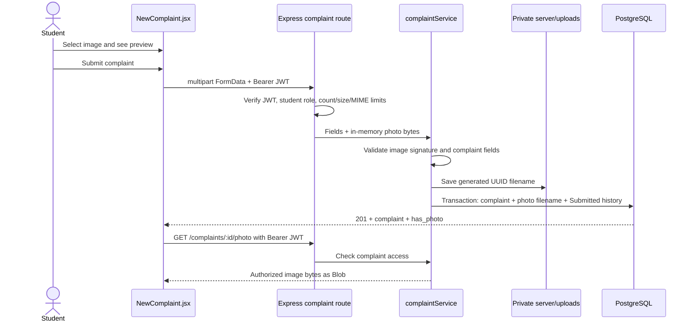

# CampusFix Feature Update Guide

**Topic:** Photo evidence, duplicate suggestions, and automatic overdue escalation  
**Purpose:** Explain what changed, how requests flow through the existing PERN architecture, how the security and matching decisions work, and how to demonstrate the update.

## 1. What was added

### Photo evidence

Students can optionally attach one JPEG, PNG, or WebP image of up to **5 MB** while reporting an issue. The form previews the selected image and supports replacing or removing it. Authorized users can view the saved evidence in complaint details.

### Duplicate complaint suggestions

When a student submits a complaint, the server checks recent reports in the same category for a similar building/location and title/description. Rejected complaints are excluded, but resolved reports are suggested too, because issues can recur. If there are likely matches, it returns a warning with a limited summary. The student can view that summary or explicitly continue with the new report. Similarity is advisory and never automatically blocks a complaint.

## 2. Files to understand

| File | What changed / why it matters |
|---|---|
| `client/src/NewComplaint.jsx` | Student report form. Builds `FormData`, validates selected type/size for immediate feedback, creates/revokes an object URL for preview, and supports replace/remove. On submit, it handles a duplicate response, displays candidate summaries, opens a privacy-limited preview, or resends with `confirmDuplicates=true` when the student chooses to continue. |
| `client/src/ComplaintEvidence.jsx` | Fetches an image through the authenticated API client, converts the returned Blob to an object URL, displays loading/error feedback, and revokes the URL when the component unmounts or complaint changes. |
| `client/src/complaintEvidence.css` | Styles the preview, duplicate warning, accessible summary dialog, and detail image responsively. |
| `client/src/App.jsx` | Routes `/complaints/new` to the new form component and includes the evidence component on the existing authorized complaint detail page. |
| `client/src/api.js` | `request()` recognizes `FormData` and lets the browser set the multipart boundary rather than forcing JSON content type. `api.create` now passes complaint `FormData` through unchanged (the category error was caused by JSON-stringifying the `FormData`, which erased its fields). `requestBlob()` fetches image bytes with the same in-memory Bearer JWT and handles 401/network errors. `api.photo` fetches photo evidence. |
| `server/src/middleware/complaintPhotoUpload.js` | Multer multipart parser. Uses memory storage, allows one field named `photo`, applies the 5 MB/file/field limits, and rejects unsupported declared MIME types. It is mounted after authentication and the student-role check. |
| `server/src/validators/evidencePhoto.js` | Authoritative server-side file validation. Checks actual byte signatures for JPEG, PNG, and WebP and verifies the declared MIME agrees with the bytes. Client checks are only for fast feedback. |
| `server/src/services/photoStorage.js` | Stores validated bytes under `server/uploads/complaints/` with a generated UUID filename and extension derived from the validated type. It never uses the user-provided filename to create a path. It also validates stored names before constructing disk paths. |
| `server/src/routes/complaintRoutes.js` | Makes `POST /api/complaints` accept the authenticated student upload. Adds `GET /api/complaints/:id/photo` for protected streaming. Both are behind the router's JWT check; creation also requires the student role. |
| `server/src/controllers/complaintController.js` | Returns `201` when it creates a complaint, or `200` with a `duplicates` list when a student needs to review possible matches. Streams authorized image bytes with the correct image MIME and `Cache-Control: private, no-store`. |
| `server/src/services/complaintService.js` | Orchestrates complaint validation, image signature validation, duplicate lookup and scoring, student confirmation, file storage, and database creation. If the database operation fails after writing a photo, it attempts to delete the unused file. It also checks photo access using the same reporter/assignee/admin policy as complaint details. |
| `server/src/models/complaintModel.js` | Persists the generated image filename with the complaint and initial history in the existing transaction. Detail/list queries expose only `has_photo`, not the disk path. Adds a parameterized candidate lookup (resolved included, rejected excluded) and an access lookup for photo metadata. |
| `server/src/domain/duplicateDetection.js` | Contains pure, explainable keyword normalization, Jaccard scoring, candidate filtering/ranking, privacy-safe result projection, and the warning-versus-create decision. |
| `server/src/domain/complaintAccess.js` | Centralizes the existing record rule: admin can access any complaint, a student can access their own, and staff can access only currently assigned complaints. The photo route uses this check. |
| `server/src/middleware/errors.js` | Maps Multer file-size failures to HTTP `413` and other Multer failures to a safe HTTP `400` message. |
| `server/src/app.js` | Allows `multipart/form-data` through the JSON-object request guard; JSON requests remain subject to the existing checks. |
| `database/schema.sql` | Adds nullable `complaints.photo_filename`, an `ALTER TABLE ... ADD COLUMN IF NOT EXISTS` for existing databases, and an index for category/status/updated-time candidate lookup. |
| `server/package.json` / `package-lock.json` | Add Multer, used to parse multipart form uploads with limits. |
| `.gitignore` | Ignores `server/uploads/` so private complaint photos are not committed. |
| `server/tests/` | Adds photo validation/storage/parser tests, duplicate matching/gating/authorization tests, and an opt-in PostgreSQL + Express integration test. |
| `server/src/services/escalationScheduler.js` | Runs a sweep immediately when the API starts, then polls on a configurable interval. Errors are logged and future sweeps continue; the timer does not keep the Node process alive. |
| `server/src/models/complaintModel.js` | Atomically marks only newly overdue active complaints and writes one system history event in the same transaction. Lists active escalations with safe filters and a whitelisted age sort. |
| `server/src/services/complaintService.js` | Validates admin escalation filters before passing them to the model. |
| `server/src/routes/complaintRoutes.js` / `server/src/controllers/complaintController.js` | Exposes `GET /api/complaints/escalated` and enforces the admin role before returning records. |
| `client/src/EscalatedComplaints.jsx` / `client/src/escalatedComplaints.css` | Admin dashboard panel with priority/status filters, oldest/newest sorting, pending age, assignee and escalation date; terminal states are not listed. |
| `server/src/config/env.js` / `server/.env.example` | Configure escalation age and polling interval with safe positive-integer defaults. |
| `server/src/server.js` / `database/schema.sql` | Start/stop the scheduler with server lifecycle; add idempotent escalation columns and a partial active-escalations index. |
| `server/tests/escalation.integration.test.js` | Exercises the real scheduler, database writes, idempotent history, age/status behavior, API filters, sort order, and role access against PostgreSQL. |

## 3. Photo upload request path



### Validation and storage decisions

1. **Optional:** no file is required. Complaints without a photo follow the original JSON-style field validation and are still stored normally (the form sends multipart fields so its optional file control works).
2. **Early browser checks:** `accept` limits the picker choices; the form checks the browser MIME and 5 MB size and gives immediate feedback. This is convenience, not security.
3. **Bounded server parser:** Multer accepts one file, caps the file at exactly `5 * 1024 * 1024` bytes, limits fields, and temporarily holds the bytes in memory. The app permits multipart through its JSON-only guard.
4. **Content verification:** `validateEvidencePhoto` checks the actual signatures: JPEG begins `FF D8 FF`; PNG has its 8-byte PNG signature; WebP has `RIFF` at bytes 0–3 and `WEBP` at bytes 8–11. The signature must match the accepted declared MIME type. Renaming a GIF or text file to `.jpg` does not make it valid.
5. **Generated path:** the storage helper creates a UUID filename and chooses `.jpg`, `.png`, or `.webp` from the validated format. The browser's original filename is never used in a filesystem path.
6. **Private serving:** photos are not mounted with `express.static` and are outside the Vite public directory. `GET /api/complaints/:id/photo` loads the complaint's stored filename, checks the caller against the complaint reporter/current assignee/admin role, then streams the file with its image MIME. The frontend fetches it with the JWT and creates a temporary Blob URL, because a plain `` cannot attach the Bearer header.
7. **Failure cleanup:** if the database transaction fails after a photo was written, the service attempts to remove that file. The complaint insert and initial history are still handled together by the existing transaction helper.

The database stores only a generated `photo_filename`, not user-controlled path segments or an externally accessible URL. Complaint API responses expose `has_photo` as a boolean. The image bytes are retrieved only through the authorized endpoint.

## 4. Duplicate detection logic

### Server-side flow

1. `POST /api/complaints` requires a valid JWT and the `student` role.
2. The service validates complaint fields and any uploaded image before duplicate evaluation.
3. `complaintModel.findDuplicateCandidates(category)` queries at most the **250 most recently updated** records in that category whose status is not `Rejected`. Resolved reports are retained so a recurring issue can prompt confirmation. The category is a SQL parameter.
4. `findSimilarComplaints` normalizes the input and candidate text: Unicode decomposition, lowercase, removal of diacritics, punctuation to spaces, tokenization, and removal of a small common-word list.
5. It calculates Jaccard similarity for location tokens, title tokens, and combined title + description tokens.
6. A candidate must have the exact same category, location similarity **at least 0.35**, and either title similarity or combined-text similarity **at least 0.20**.
7. Matches are ranked with this score:

   ```text
   score = 0.40 × location similarity
         + 0.35 × title similarity
         + 0.25 × combined title/description similarity
   ```

8. The API returns up to five top matches with only `id`, `title`, `location`, `status`, and `similarity`. It does not include reporter name/email, description, or staff information.
9. With matches and no confirmation, the API returns HTTP `200` with `{ "duplicates": [...] }` and does not insert a complaint or write history. The UI shows a warning and a safe summary dialog.
10. **Continue anyway** resends the report with `confirmDuplicates=true`. The server reruns the query and scoring, then creates it even if matches remain. Duplicate detection warns but never blocks. With no matches, creation immediately returns HTTP `201` as before.

### Explainable example

New report:

- Category: `Electrical`
- Title: `Ceiling light flickering`
- Description: `The lamp flickers during evening classes in the north block.`
- Location: `North Block, Room 204`

Existing unresolved report:

- Category: `Electrical`
- Title: `Ceiling light flickering!`
- Description: `The lamp flickers during evening classes in the north block`
- Location: `north block room 204`

Normalization removes punctuation and case, so the location, title, and combined-text token sets match. Their Jaccard similarities are 1.0 and the score is 1.0. A `Submitted`, `Assigned`, `In Progress`, or `Resolved` match can be suggested. A `Rejected` record is excluded before scoring and again by the pure candidate matcher as a second safeguard. When a suggested record is resolved, the UI explicitly tells the student it may have returned and asks them to choose whether to continue.

### Privacy boundary

The duplicate check is reachable only after authentication and the student role check. It discloses only the minimal fields for a relevant match (reference ID, title, location, and status) to help the student decide. It does not grant access to the full complaint detail endpoint: another student's detail and image remain protected by record-level authorization. The **View report** dialog is a limited preview of those allowed fields, not the reporter's private description or identity.

## 5. Database changes and setup

`database/schema.sql` now:

- Adds `photo_filename TEXT` to `complaints`, nullable so old and new complaints without images remain valid.
- Uses `ALTER TABLE complaints ADD COLUMN IF NOT EXISTS photo_filename TEXT`, so rerunning initialization upgrades an existing database without dropping data.
- Adds `complaints_duplicate_candidates_idx` on `(category, status, updated_at DESC)` to support the duplicate candidate query.

After pulling the change, from the project root run:

```sh
npm install
npm run db:init
```

No database data reset is needed. The upload directory is created on the first saved photo. Back up `server/uploads/complaints/` with the PostgreSQL database. In production, mount persistent private disk at that path or replace this storage adapter with a private object-storage service; do not expose the directory through a public static route.

## 6. Tests and verification

### Standard tests

```sh
npm test --workspace server
npm run build
```

Coverage added:

- JPEG, PNG, and WebP signatures accepted when MIME matches.
- Unsupported type, mismatched signature, empty file, and over-limit file rejected.
- Multipart parser accepts one supported image, rejects unsupported MIME, and returns 413 above 5 MB.
- Storage uses a generated safe filename, prevents path traversal, and removes files correctly.
- Normalization/matching detects similar candidates, includes resolved reports, excludes rejected reports, and returns only safe fields.
- Category/location mismatch candidates do not trigger warnings.
- Rejected status is excluded; resolved reports are suggested as a possible recurring issue and require explicit student confirmation to proceed.
- Duplicate flow warns first and explicit confirmation changes the decision to create.
- Student reporter, assigned staff, and admin access policy is covered; unrelated students are denied.

### PostgreSQL + Express integration

The integration test creates uniquely named temporary student accounts and complaints, then removes the database rows and any generated photo in `finally`. It verifies actual multipart creation, image retrieval, rejection of a JPEG-MIME spoof with invalid signature, denial of another student's image request, duplicate response contents/privacy, explicit continuation, inclusion of a resolved match, and exclusion of a rejected match.

After `npm run db:init`, run it explicitly:

```powershell
$env:CAMPUSFIX_INTEGRATION_TEST = '1'
npm test --workspace server
Remove-Item Env:CAMPUSFIX_INTEGRATION_TEST
```

This opt-in avoids unexpectedly writing test data into a developer's configured database during the ordinary unit test run.

## 7. Demo script for a mentor

1. Start PostgreSQL, run `npm run db:init`, then `npm run dev`.
2. Register/sign in as a student and open **Report an issue**.
3. Select a JPEG/PNG/WebP under 5 MB and show its preview; replace it or remove it, then select it again.
4. Submit a report that deliberately resembles an existing complaint. Show the candidate reference, title, location, and status; if the report is resolved, point out the recurring-issue prompt. Select **View report** and explain why the preview omits reporter identity and description.
5. Choose **Continue with new complaint**. Explain that the server repeats the check but never blocks creation after confirmation.
6. Show the created detail page and photo. Sign in as the administrator or assigned staff and show that they can view the same photo. A different student's photo request returns 403.
7. Resolve/reject a candidate through the existing workflow and submit the same report again; resolved/rejected items no longer appear in suggestions.

Suggested viva explanation:

> Photo upload is optional and uses multipart form data. Multer enforces the one-file and 5 MB limits; the backend verifies image signatures and generates a UUID filename. Files stay outside the public directory, and the photo endpoint reuses complaint ownership/assignment checks. Duplicate detection is deterministic: same category, normalized location/title/description token overlap, and Jaccard thresholds. It returns a minimal warning, then lets the student confirm a new report without blocking it.

## 8. Trade-offs and remaining limitations

- **Local disk:** simplest fit for this single-server project and avoids a paid external service. Deployments need persistent private storage and backups. Multiple API instances require shared storage or a move to private object storage.
- **Memory upload parsing:** makes it straightforward to inspect bytes before writing and is bounded to 5 MB per file, but concurrent uploads consume memory. A high-volume deployment should use streaming or object storage.
- **No image re-encoding:** the server checks MIME/signature and serves only recognized image MIME types, but it does not resize, strip metadata, or decode/re-encode pixels. Add a maintained image-processing pipeline before accepting untrusted images at larger scale.
- **No automatic orphan sweeper:** a handled database failure triggers file cleanup, but a process crash between file creation and row commit could leave an orphan. A scheduled reconciliation task can address this if needed.
- **Heuristic matches:** keyword Jaccard can produce false positives/negatives (synonyms and paraphrases are difficult). Matching is explainable and advisory, and student confirmation preserves valid distinct reports.
- **Candidate cap:** only the latest 250 non-rejected rows in the same category are evaluated per submission. This is reasonable for the project scale; larger deployments should use database full-text/trigram indexes and pagination/ranking.
- **Frontend automation:** backend unit/integration tests cover API behavior and `npm run build` checks React compilation. The file picker, preview, modal appearance, and responsive layout should still be manually demonstrated in a browser.


## 9. Automatic overdue escalation

### Data and migration

`database/schema.sql` adds `complaints.is_escalated BOOLEAN NOT NULL DEFAULT FALSE` and nullable `complaints.escalated_at TIMESTAMPTZ`. Both are included in table creation and added with `ALTER TABLE ... ADD COLUMN IF NOT EXISTS` for existing databases. Existing complaint rows are preserved and default to not escalated. A partial index covers active escalated complaints by priority and age. Run `npm run db:init` to apply the additive schema update.

### Background task

`server/src/server.js` starts `server/src/services/escalationScheduler.js` with the API and stops its timer during graceful shutdown. It sweeps immediately and then polls every `ESCALATION_POLL_INTERVAL_MS` milliseconds (default 60,000). `ESCALATION_THRESHOLD_DAYS` defaults to 7. The Node process must remain running; no separate cron or scheduler service is needed. If the API is stopped, the startup sweep catches up once it returns.

Each sweep uses a PostgreSQL transaction and only updates unresolved active statuses (`Submitted`, `Assigned`, `In Progress`) with `created_at` older than the threshold and `is_escalated=FALSE`. The same transaction inserts one `escalation` event in `complaint_history`. The conditional update is atomic, so repeated sweeps and multiple API instances will not reset the timestamp or duplicate the event. The history actor is null to identify this as a system action; complaint details render the actor as CampusFix system.

Resolved and rejected records are never newly escalated and do not appear in the active escalation endpoint. If an already-escalated complaint is later resolved/rejected, its flag, first escalation time, and event are retained. There is no reopen action in the current workflow; if one is added later, changing it back to an active status will make its prior escalation visible again with the original timestamp.

### Admin panel and authorization

`GET /api/complaints/escalated` is protected by `authenticate` and `allowRoles('admin')`; the check runs in Express regardless of what the React UI displays. Optional `priority` and active `status` filters are validated by the service. `sort=age_desc` lists oldest first; `sort=age_asc` lists newest first. The model uses a fixed whitelist for SQL sort clauses and parameters for filter values.

`client/src/EscalatedComplaints.jsx` appears on the admin dashboard. It displays ID/title, category, priority, location, status, creation date, pending days, current staff assignee, and escalation date, with age/priority styling and links to complaint details. The endpoint only returns active escalations; students and staff cannot use it to list all escalated complaints. Their existing complaint permissions remain unchanged.

### How to test

The opt-in `server/tests/escalation.integration.test.js` uses a real PostgreSQL database. With `npm run db:init`, run:

```powershell
$env:CAMPUSFIX_INTEGRATION_TEST = '1'
npm test --workspace server
Remove-Item Env:CAMPUSFIX_INTEGRATION_TEST
```

The test ages fixture rows to verify: under-threshold complaints remain unchanged; overdue active complaints are escalated; resolved/rejected rows are skipped; repeated sweeps preserve `escalated_at` and create one history event; the scheduler works without a dashboard request; filters and sorting return database-backed rows; and anonymous/student access is denied.

